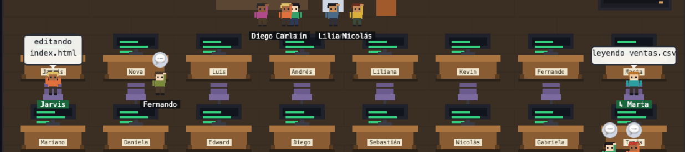

# Agentes-OC

**Paquete de Agentes y SubAgentes IA para OpenCode** — sitio web visual con el inventario completo de tu ecosistema (agentes, subagentes, skills, seguridad, plugins, MCP, guion de llamada) **+ paquete instalable** de los 56 agentes para cualquier Mac o Windows **+ oficina pixel** para ver a tu equipo trabajando.

## 🏢 Nuevo: ahora también puedes ver a tu equipo

Además de tener tus agentes, puedes verlos en una oficina pixel art: cada uno con su nombre, su ropa y su escritorio. Cuando OpenCode trabaja ves en vivo quién lo hace y en qué (editando, investigando, ejecutando, esperando permiso, error); cuando descansan, leen, juegan ping-pong, toman café o charlan. Todo local, en `127.0.0.1`.



```bash
bash oficina/instalar.sh            # macOS / Linux  (Windows: oficina\instalar.ps1)
~/.agentes-oc/oficina/oficina       # arranca y abre la oficina
```

Detalles, personalización y desinstalación: **[`oficina/README.md`](oficina/README.md)**.

   

---

## 📥 Cómo instalar (nuevo)

- **📖 Guía completa paso a paso** (macOS + Windows + prompt de autoinstalación): lee **[`COMO_INSTALAR.md`](COMO_INSTALAR.md)**.
- **🚀 Instalación rápida** en tu máquina actual:

```bash
# 1. Clona el repo
git clone https://github.com/DuvanP11/Agentes-OC.git ~/dev/Agentes-OC
cd ~/dev/Agentes-OC

# 2. Instala los 56 agentes (hace backup de tu config primero)
bash install.sh               # macOS / Linux
powershell -ExecutionPolicy Bypass -File install.ps1   # Windows

# 3. Verifica
opencode agent list

# 4. (Nuevo) Oficina pixel para ver al equipo — necesita Node 20+
bash oficina/instalar.sh && ~/.agentes-oc/oficina/oficina
```

> ¿Prefieres que lo haga una IA? En [`COMO_INSTALAR.md`](COMO_INSTALAR.md#-instalación-automática-con-un-prompt) hay prompts para pegar en **Claude Code** u **OpenCode**: uno instala todo y otro solo la oficina.

> El instalador **no borra** tus agentes existentes: hace backup y fusiona los del paquete.

---

## 🚀 Desplegar la web en Vercel

El sitio es **100% estático** (HTML + CSS + JS, sin build). Conectarlo a Vercel toma menos de 2 minutos:

### Opción A — Desde el dashboard de Vercel (recomendada)

1. Ve a [vercel.com/new](https://vercel.com/new).
2. Importa el repositorio `DuvanP11/Agentes-OC` (conecta tu cuenta de GitHub si no lo está).
3. **Importante:** el nombre del proyecto no puede llevar mayúsculas → usa **`agentes-oc`** (o renombra el repo a `agentes-oc`).
4. Vercel detecta automáticamente que es un proyecto estático (framework: **Other**).
5. Haz clic en **Deploy**. Listo: obtienes una URL `https://agentes-oc.vercel.app`.

### Opción B — Desde la CLI de Vercel

```bash
npm i -g vercel
vercel            # primer deploy (preview)
vercel --prod     # deploy a producción
```

> No se necesitan variables de entorno ni funciones serverless: es un sitio estático puro.

---

## 🧠 ¿Qué contiene la web?

| Sección | Qué muestra |
|---|---|
| **Esquema** | Diagrama visual (Mermaid) del ecosistema: director → equipo de producto → especialistas → build → revisión → seguridad |
| **Agentes** | 56 agentes (7 primarios + 49 subagentes) con descripción, categoría y cuándo usarlos. Filtros y búsqueda |
| **Guion de llamada** | Tabla tarea → agente → prompt sugerido para invocar cada especialista |
| **Skills** | 237 skills, agrupadas por dominio, con búsqueda y filtros |
| **Seguridad** | Agentes de seguridad, runtime antimalware (sentinel), políticas y capas de defensa |
| **Oficina** | Nuevo: capturas y explicación de la oficina pixel donde ves a tu equipo trabajar |
| **Instalación** | Paso a paso para instalar los 56 agentes y la oficina en Mac/Windows + prompts de autoinstalación (Claude Code u OpenCode) |
| **Recursos** | Paquetes y comandos para que OpenCode funcione bien en **macOS** y **Windows** |

---

## 📦 Paquete de agentes instalable

El repo incluye las definiciones reales (exportadas desde OpenCode) de los **56 agentes**:

```
agents/
├── manifest.json              # Índice del paquete
├── <agente>.json              # Definición limpia (name, mode, description, temperature, tools, prompt)
└── <agente>.md                # Versión legible (documentación)
```

### Regenerar el paquete desde tu OpenCode

Si modificas agentes y quieres actualizar el paquete:

```bash
bash scripts/export-agents.sh
git add agents/ && git commit -m "chore: actualizar paquete de agentes" && git push
```

---

## 🛠️ Recursos para OpenCode

### macOS

```bash
# opencode CLI
curl -fsSL https://opencode.ai/install -o install.sh && bash install.sh

# Base del sistema
brew install node python jq git gh

# Seguridad (opcional pero recomendado)
brew install semgrep
pip3 install pytest
```

### Windows (PowerShell)

```powershell
# opencode CLI
irm https://opencode.ai/install.ps1 | iex

# Base del sistema
winget install OpenJS.NodeJS.LTS
winget install Python.Python.3.12
winget install Git.Git
winget install Microsoft.WindowsTerminal
winget install jqlang.jq
winget install GitHub.cli

# Seguridad (opcional)
pip install semgrep
```

---

## 🔒 Seguridad incluida

- **`security-engineer`** — subagente AppSec integral (código, dependencias, secretos, auth, skills/MCP, CI/CD).
- **`security-reviewer`** — revisión focalizada post-diff.
- **Runtime antimalware** — plugin `security-agent.ts` + hooks Python (`sentinel_preflight.py` / `sentinel_postflight.py` / `skill_scanner.py` / `skill_validator.py`) + IOCs firmados.
- **Puertas de seguridad** en `director` y `fullstack-product-engineer` antes de aceptar entregables.

---

## 📁 Estructura del repo

```
Agentes-OC/
├── index.html          # Página principal (esquema + secciones)
├── COMO_INSTALAR.md    # Guía paso a paso (Mac/Windows) + prompt de autoinstalación
├── install.sh          # Instalador de agentes (macOS/Linux)
├── install.ps1         # Instalador de agentes (Windows)
├── agents/             # Paquete de 56 agentes (JSON + MD + manifest)
├── oficina/            # Oficina pixel: plugin, web, instaladores (ver oficina/README.md)
├── assets/             # Capturas de la oficina
├── scripts/
│   └── export-agents.sh# Regenera el paquete desde tu OpenCode
├── css/styles.css      # Tema oscuro profesional
├── js/data.js          # Inventario: agentes, guion, seguridad, plugins, MCP, recursos
├── js/skills.js        # Inventario de skills
├── js/app.js           # Renderizado, búsqueda, filtros, tabs
└── README.md
```

---

## ✏️ Cómo actualizar el inventario

Los datos viven en `js/data.js` y `js/skills.js`. Para regenerar el inventario real desde tu OpenCode:

```bash
opencode agent list          # lista de agentes
opencode debug skill         # lista de skills
opencode debug config        # config resuelta (agentes, plugins, MCP)
opencode mcp list            # servidores MCP
```

Edita los arrays correspondientes y haz push: Vercel redeploya automáticamente.

---

## 📄 Licencia

MIT — úsalo, adáptalo y compártelo.