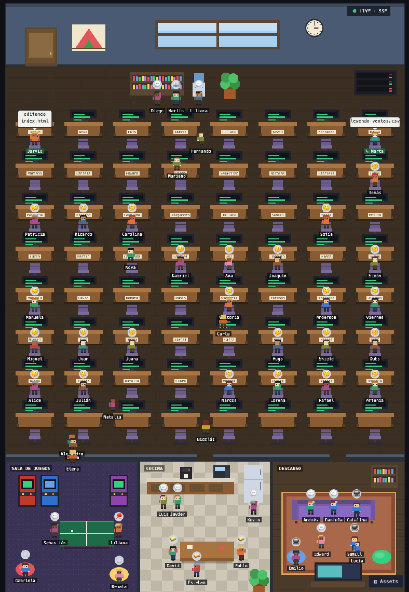

# 🏢 Oficina pixel — ve a tu equipo de agentes trabajando

Además de **tener** tu equipo de 56 agentes en OpenCode, ahora puedes **verlo**:
una oficina pixel art donde cada agente tiene su nombre, su ropa y su
escritorio, y donde ves en vivo quién está trabajando y en qué.



## Qué ves

| En la oficina | Qué significa |
|---|---|
| Etiqueta **verde** | Sesión **real** de OpenCode conectada ahora mismo |
| Agente en **su escritorio** con globo blanco | Trabajando de verdad: ✍️ editando un archivo, 🔍 investigando, ⚙️ ejecutando, 💭 pensando |
| Agente en la **puerta** | Esperando: un permiso, una pregunta tuya o la cuota del proveedor ("sin cuota · reintento N") |
| Agente junto al **servidor** (tinte rojo) | Error real de la sesión |
| `↳ Nombre` | Subagente que llamó el agente principal (sale 8 s después de terminar) |
| Etiqueta oscura + globo **gris** | Compañero en reposo: lee, toma agua, juega arcade o ping-pong, toma café, come, ve TV o charla. Es ambiente de oficina, **no** trabajo |

- **64 escritorios**: los 56 primeros tienen una **placa con el nombre** de su
  agente; los 8 últimos son libres (agentes nuevos o una segunda sesión).
- **Salas de descanso** con muro y puerta: sala de juegos, cocina y descanso.
- **Nombres humanos** por tipo de agente (director = Jarvis, data-analyst =
  Marta…) en [`web/assets/nombres.json`](web/assets/nombres.json). Cámbialos y
  recarga la página.
- **El equipo vive en la oficina** aunque no lo hayas llamado. Cuando OpenCode
  abre una sesión de un agente, su compañero "se convierte" en la sesión real
  (etiqueta verde) y va a su escritorio.
- **Nunca muestra secretos**: ni comandos de bash ni patrones de búsqueda; solo
  el nombre del archivo o la descripción corta de la tarea.
- **Nunca frena a OpenCode**: si la oficina está cerrada, OpenCode funciona
  igual; al abrirla, las sesiones entran solas en ~15 s.
- Todo es **local** (`127.0.0.1:4099`): no sale nada de tu computador.

## Instalar

Necesitas `git` y **Node 20+** (además de OpenCode).

```bash
# macOS / Linux (desde la carpeta del repo)
bash oficina/instalar.sh

# Windows (PowerShell)
powershell -ExecutionPolicy Bypass -File oficina\instalar.ps1
```

El instalador:
1. Descarga [Agent-Office](https://github.com/shreyashp47/Agent-Office) (MIT)
   en una versión fija y lo compila, sin ejecutar scripts de instalación de npm.
2. Copia la web de esta carpeta (escena, nombres, arreglos).
3. Copia el plugin `pixel-office.ts` a `~/.config/opencode/plugins/`
   (si ya había uno distinto, lo respalda antes).
4. Deja el lanzador en `~/.agentes-oc/oficina/`.

**Reinicia OpenCode una vez** para que cargue el plugin.

## Usar

```bash
~/.agentes-oc/oficina/oficina           # arranca y abre el navegador
~/.agentes-oc/oficina/oficina status    # quién está conectado
~/.agentes-oc/oficina/oficina stop      # la cierra (OpenCode sigue igual)
```

En Windows: `powershell -ExecutionPolicy Bypass -File "$env:USERPROFILE\.agentes-oc\oficina\oficina.ps1"` (añade `status` o `stop`).

**Dentro de VS Code**: `Cmd/Ctrl+Shift+P` → `Simple Browser: Show` →
`http://127.0.0.1:4099/?demo=0`. Pon la terminal a la derecha (clic derecho
en *Terminal* → *Panel Position → Right*) y usa `Cmd −` para ver la oficina
entera.

No uses los botones *Idle / Writing / …* bajo la oficina: son controles de
prueba de Agent-Office y crean un agente falso "Primary".

## Personalizar

| Quiero… | Edita |
|---|---|
| Cambiar nombres | `web/assets/nombres.json` → `agentes` |
| Quién vive en la oficina | `web/assets/nombres.json` → `equipo` (`"todos"` o una lista) |
| Más o menos escritorios | `generar-escena.py` (`FILAS`, `COLS`) y ejecútalo |
| Apagar el plugin sin borrarlo | variable `PIXEL_OFFICE_OFF=1` |

Después de editar en el repo, vuelve a ejecutar el instalador (respalda la web
anterior) o copia el archivo a `~/.agentes-oc/oficina/runtime/frontend/dist/`.

## Cambios sobre Agent-Office

La carpeta `web/` es el frontend de Agent-Office (MIT, © Shreyash Patil,
[`LICENSE-AGENT-OFFICE`](LICENSE-AGENT-OFFICE)) con estos cambios, marcados en
el código con `pixel-office-opencode`:

- `logic.js`: cada agente ocupa un puesto **libre** y conserva su escritorio
  (antes varios caían en el mismo sitio).
- `sprites.js`: **arreglo del parpadeo** — el original dibujaba todos los
  cuadros de animación en la columna 0, así que los cuadros 1…3 quedaban vacíos
  y el personaje desaparecía a cada rato.
- `character.js`: animación tranquila, paso por las puertas de las salas,
  etiqueta verde para sesiones reales.
- `scene.js`: muebles de las salas (arcades, ping-pong, cocina, TV, puffs…) y
  placas con nombre.
- `main.js`: nombres humanos, equipo residente, escritorio por agente y vida de
  oficina en reposo.

El plugin `plugin/pixel-office.ts` reemplaza al `office-sync.ts` original: un
personaje por **sesión** y por **subagente**, estados sacados de eventos
reales de OpenCode (herramientas, permisos, reintentos, errores).

## Desinstalar

```bash
~/.agentes-oc/oficina/oficina stop
rm ~/.config/opencode/plugins/pixel-office.ts
rm -rf ~/.agentes-oc/oficina
```
